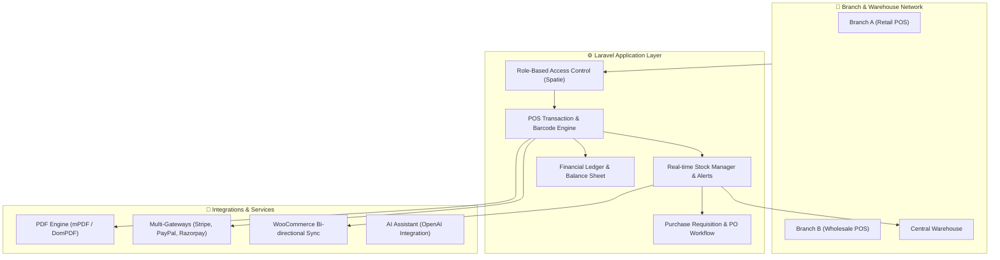

# Enterprise Inventory & Multi-Location POS Management System

[](https://laravel.com)
[](https://www.php.net)
[](https://www.mysql.com)
[]()
[]()

An enterprise-ready **Inventory, Supply Chain, and Multi-Branch Point of Sale (POS)** application architected on **Laravel 9** and **MySQL**. Engineered to handle high-frequency checkout operations, dynamic stock reconciliation across multi-warehouse setups, automated purchase requisitions, and end-to-end accounting analytics.

---

## 📌 Executive Architectural Overview

This system coordinates multi-location retail and wholesale workflows into a consolidated backend:



---

## 🌟 Key Functional Modules

### 1. 📦 Multi-Location Inventory & Stock Ledger
- **Multi-Warehouse / Branch Tracking:** Real-time stock counts across multiple physical branches and central depots with inter-branch stock transfers.
- **Product Variants & Attributes:** Support for matrix variations (SKU, size, color, expiry dates, batch numbers, and lot tracking).
- **Automated Stock Alerts:** Real-time threshold monitoring triggering automated low-stock warnings and re-order requisitions.
- **Barcode & Label Generation:** Thermal and A4 sticker sheet printing with standard 1D/2D symbologies (Code128, EAN-13, QR codes) using `milon/barcode`.

### 2. ⚡ High-Speed Point of Sale (POS)
- **Keyboard-Driven Terminal:** Optimized for rapid barcode scanning and sub-second checkout operations.
- **Service Staff & Commission Tracking:** Staff allocation per sale, service timer pauses/resumes, and commission calculations.
- **Drafts, Quotations, and Suspended Sales:** Park active carts to serve concurrent walk-in customers.
- **Multi-Payment Settlement:** Split payments across cash, card, credit balances, and digital payment gateways.

### 3. 🔄 Procurement & Purchase Requisitions
- **Purchase Requisition Engine:** Department-level requisition requests, manager approvals, and automated conversion into Purchase Orders (PO).
- **Supplier Ledger & Accounts Payable:** Track purchase dues, partial receipts, return merchandise authorizations (RMA), and vendor credit memos.

### 4. 🔐 Security, Audit Trails & Granular RBAC
- **Permission Matrix:** Fine-grained role permissions powered by `spatie/laravel-permission` (Admin, Branch Manager, Cashier, Inventory Clerk).
- **Tamper-Evident Activity Logging:** Complete system-wide audit logs powered by `spatie/laravel-activitylog` capturing user impersonation, price modifications, and stock adjustments.

### 5. 📊 Financials, Analytics & Export Engine
- **Accounting Statements:** Automated generation of Profit & Loss statements, gross margin analysis, sales tax registers, and cash register reconciliation.
- **Server-Side Data Tables:** Seamless pagination and search across 100,000+ transaction rows using `yajra/laravel-datatables`.
- **Exporting Capabilities:** Background queue processing for Excel exports (`maatwebsite/excel`) and high-fidelity invoice PDF rendering (`mpdf/mpdf`).

### 6. 🔌 Third-Party Integrations
- **Payment Gateways:** Built-in SDK drivers for **Stripe**, **PayPal**, **Razorpay**, and **Paystack**.
- **E-Commerce Sync:** Bi-directional product stock and order synchronization with **WooCommerce REST API**.
- **SMS & Cloud Communication:** Automated customer invoice notifications via **Twilio SMS**.

---

## 🛠️ Technology Stack & Dependencies

| Layer | Technologies / Packages |
|---|---|
| **Backend Framework** | PHP 8.0 / 8.1, Laravel 9.x |
| **Database** | MySQL 8.0 / MariaDB (Optimized indexed transactions) |
| **Frontend & UI** | AdminLTE 3 (Bootstrap 4), jQuery, DataTables, Chart.js / Highcharts |
| **API & Auth** | Laravel Passport (OAuth2 API tokens), Spatie Permissions |
| **Reporting & Export** | mPDF, DomPDF, Maatwebsite Excel, Laravel DataTables |
| **Background Processing**| Laravel Queues, Database / Redis driver |
| **AI Integration** | OpenAI PHP Laravel SDK |

---

## ⚙️ Local Development & Installation

### Prerequisites
- **PHP:** `>= 8.0` with `bcmath`, `ctype`, `fileinfo`, `json`, `mbstring`, `openssl`, `pdo_mysql`, `tokenizer`, `xml`
- **Composer:** `>= 2.2`
- **Node.js & NPM:** `Node 16+` / `NPM 8+`
- **Database:** MySQL 8.0+ / MariaDB 10.4+

### Step-by-Step Setup

```bash
# 1. Clone the repository
git clone https://github.com/alramim07/inventory-management-system.git
cd inventory-management-system

# 2. Install PHP dependencies
composer install --optimize-autoloader

# 3. Install frontend assets
npm install
npm run dev

# 4. Environment configuration
cp .env.example .env
php artisan key:generate

# 5. Configure your database in .env
# DB_CONNECTION=mysql
# DB_HOST=127.0.0.1
# DB_PORT=3306
# DB_DATABASE=inventory_pos
# DB_USERNAME=root
# DB_PASSWORD=

# 6. Run database migrations and seed system defaults
php artisan migrate --seed

# 7. Link storage directory
php artisan storage:link

# 8. Start local development server
php artisan serve
```

Access the system at `http://127.0.0.1:8000`.

---

## 🧪 Testing & Code Quality

```bash
# Run unit and feature test suites
php artisan test

# Run static analysis / inspection
./vendor/bin/phpunit
```

---

## 📄 License
This codebase is distributed under the [MIT License](LICENSE).
